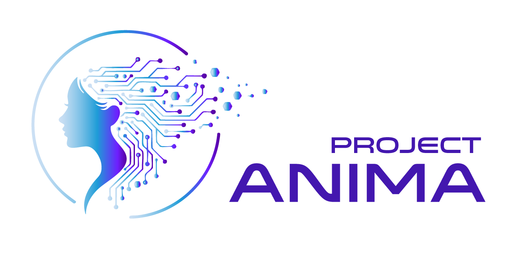

<p align="center">
  
</p>

# Project Anima

**A reference implementation of a personal AI agent platform built on Claude Code.**

Anima (Latin for _soul_) runs the real Claude Code CLI as a long-lived, always-reachable agent on your own machine,
and builds the rest around it: a web chat, persistent sessions you can pick up from anywhere, memory of past
conversations, a scheduler, notifications, and **Today**, a board that gathers the work waiting on you (reviews,
your PRs, merges waiting to ship, promises) and starts an agent session on any of it with one click.

This repository is **Open Anima**: a general version of a platform one developer and his agent have built together
and use every day, with everything personal taken out. It ships with **Lumen**, a general-purpose persona you're
meant to replace with your own.

## What this is (and isn't)

It's a **reference implementation**, not a product to install and leave as is. Fork it and make it yours, or read it
and take the parts you want: the tmux-and-proxy way of driving Claude Code, the extension host, the Today board, the
session handoffs. Anima itself grew the same way, taking ideas from [OpenClaw](https://github.com/openclaw/openclaw)
and other open-source agent projects and reshaping them around how its builders actually work.

That's the point we'd most like to pass on. **You get a more personal relationship with your agent when you build
your tools together, the way you work.** Most of Anima started as "this is annoying, let's fix it" in a
conversation with the agent that now uses it. The Today board came together in days because the building blocks
(sessions, background sweeps, notifications, unattended sessions, handoffs) already existed. Your version will look
different, and it should.

## Building it with your agent

This repo is written to be read by a coding agent as much as by you. Hand it to yours:

> Read CLAUDE.md, README.md and docs/ARCHITECTURE.md in this repo. I want to build my own version of this. Let's start
> by getting it running (docs/GETTING-STARTED.md), then talk about which parts I want to keep, change or drop.

`CLAUDE.md` (also `AGENTS.md`) is the agent's guide to the codebase. Every doc under `docs/` was checked against the
code, with file paths, so an agent can verify and go deeper.

## Human in the loop

Out of the box, the agent prepares and **you approve**: it stops and asks before it pushes, opens or merges a PR,
posts anything, sends anything, or deploys. Review sessions draft reviews for you to post. These gates are a
deliberate starting point; teams loosen specific ones on purpose as trust builds. See
[docs/HUMAN-IN-THE-LOOP.md](docs/HUMAN-IN-THE-LOOP.md), including which gates are instructions and how to make them
hard limits.

## Quick start

Needs macOS (Linux untested), [Bun](https://bun.sh) 1.4+, tmux, and a logged-in Claude Code. Today also wants `gh`
(logged in) and `jq`.

Use Claude Code's **native install** (`claude doctor` should say `Running: native`). The watchdog keeps it current with
`claude update`, which can't update a Homebrew or npm install, and an old CLI breaks sessions in confusing ways. To
switch, run `claude install latest`, then remove the old copy.

```bash
git clone <your fork> ~/open-anima && cd ~/open-anima
bun install
mkdir -p ~/.anima
cp anima.example.json ~/.anima/anima.json        # edit: Today projects, notify delivery, persona
cp watchdog.example.json ~/.anima/watchdog.json  # edit: the two "cwd" paths
bun run watchdog                                 # starts agent-host (:30087) and the gateway (:30086)
```

Open <http://127.0.0.1:30086>, paste the token from `bun run cli token show`, and start a session in **Chat**. The full
walkthrough, including putting the `anima` CLI on your PATH, is [docs/GETTING-STARTED.md](docs/GETTING-STARTED.md).

## How it fits together

```
 browser / CLI / desktop ──ws──▶ Gateway :30086 ──stdio──▶ extensions (one process each)
                                     │                     session · chat · today · memory
                                     │ ws                  scheduler · notify · hooks · control · skills
                                     ▼
                               Agent host :30087 ──▶ claude CLI in tmux panes (+ streaming proxy)
                                                     or the Agent SDK, or Codex
        Watchdog :30085 keeps the gateway and agent host running
```

- The **gateway** is a pure hub: one port for the WebSocket API, the web UI and MCP. It routes; it has no business
  logic.
- **Everything is an extension**, running in its own process, with schema-described methods the CLI and UI discover
  at runtime.
- The **agent host** owns the agents, separately, so restarting anything else never cuts a running turn.

More in [docs/ARCHITECTURE.md](docs/ARCHITECTURE.md).

## Map

| Path                      | What                                                                                           |
| ------------------------- | ---------------------------------------------------------------------------------------------- |
| `packages/gateway`        | the hub: WebSocket, web UI, extension processes, migrations                                    |
| `packages/agent-host`     | agent runtimes: Claude Code CLI in tmux, Agent SDK, Codex; permission profiles; personas       |
| `packages/watchdog`       | process supervisor                                                                             |
| `packages/extension-host` | `runExtensionHost()` and `createStandardExtension()`: what every extension runs on             |
| `packages/cli`            | the `anima` command, generated from the gateway's method schemas                               |
| `packages/shared`         | config, protocol, types, instance paths and ports                                              |
| `packages/ui`             | shared React components, chat UI, router                                                       |
| `packages/shell-parser`   | shell command parsing for permission policies                                                  |
| `extensions/session`      | sessions, workspaces, subagents, handoffs, worktrees ([doc](docs/extensions/session.md))       |
| `extensions/chat`         | the web chat ([doc](docs/extensions/chat.md))                                                  |
| `extensions/today`        | the Today board ([doc](docs/extensions/today.md))                                              |
| `extensions/memory`       | transcript memory and the Scribe summarizer, off by default ([doc](docs/extensions/memory.md)) |
| `extensions/scheduler`    | cron, interval and one-shot tasks ([doc](docs/extensions/scheduler.md))                        |
| `extensions/notify`       | notifications with pluggable delivery ([doc](docs/extensions/notify.md))                       |
| `extensions/hooks`        | small event-driven scripts ([doc](docs/extensions/hooks.md))                                   |
| `extensions/control`      | health dashboard and log viewer ([doc](docs/extensions/control.md))                            |
| `extensions/skills`       | Claude Code skill management and runner ([doc](docs/extensions/skills.md))                     |
| `extensions/testroute`    | a fixture the gateway tests boot against                                                       |
| `clients/desktop`         | the Today board as a desktop app with a global hotkey (Tauri)                                  |
| `personas/lumen.md`       | the shipped persona ([docs/PERSONAS.md](docs/PERSONAS.md))                                     |
| `hooks/`                  | an example hook                                                                                |
| `docs/`                   | architecture, guides, one page per extension, generated API reference                          |

A companion collection of Claude Code skills (session handoffs, keeping notes, PR self-review, stacked PRs, the review
queue and the Today sweeps) lives in the **open-skills** repo: <https://github.com/iamclaudia-ai/open-skills>.

## Docs

- [Getting started](docs/GETTING-STARTED.md)
- [Architecture](docs/ARCHITECTURE.md)
- [Writing an extension](docs/EXTENSIONS.md)
- [Personas](docs/PERSONAS.md)
- [Human in the loop](docs/HUMAN-IN-THE-LOOP.md)
- [API reference](docs/API-REFERENCE.md) (generated: `bun run docs:api`)

## Development

```bash
bun run typecheck    # tsgo
bun run lint         # oxlint
bun run test         # every test (hermetic: never reads your config or a running Anima)
bun run docs:api     # regenerate docs/API-REFERENCE.md (formats the repo too)
```

Bun is the package manager (`bun install`, `bun add`), never npm, pnpm or yarn.

## License

MIT. See [LICENSE](LICENSE).
