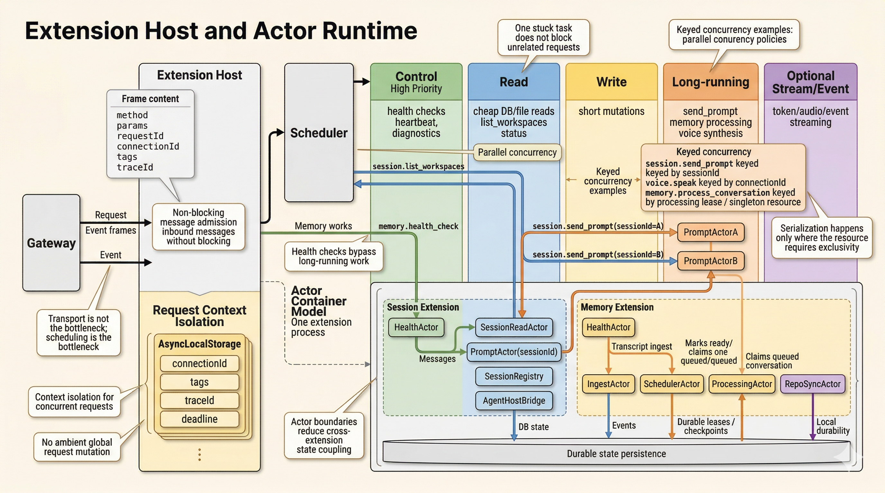

# Writing an extension

Every feature in Anima is an extension: a folder under `extensions/<id>/` that the gateway runs as its own process.
An extension can have methods (callable from the web UI, the CLI, other extensions and agent sessions), events, web
pages, MCP tools for agents, and local CLI commands. This page covers how to build one. [ARCHITECTURE.md](ARCHITECTURE.md)
explains how extensions fit into the whole.

If you're working with a coding agent, point it at `.agents/skills/anima-extension/` too: a skill with the same rules
and two worked examples (`references/basic-extension.md`, `references/advanced-extension.md`).

## The shape

```
extensions/<id>/
  package.json        # "@anima/ext-<id>", workspace deps on @anima/shared, @anima/extension-host (+ @anima/ui for pages)
  src/
    index.ts          # the server side: methods, events, lifecycle (required)
    routes.ts         # web pages (optional)
    pages/            # React components for those pages
    cli.ts            # local CLI commands (optional, rare)
```

The gateway finds the entry by convention at `extensions/<id>/src/index.ts`, and the web shell finds pages at
`extensions/<id>/src/routes.ts`. Nothing is registered by hand.

## A minimal extension

```ts
// extensions/hello/src/index.ts
import { z } from "zod";
import { createStandardExtension, runExtensionHost } from "@anima/extension-host";

const GreetParams = z.object({ name: z.string().min(1).default("world") });

export function createHelloExtension(config: Record<string, unknown> = {}) {
  return createStandardExtension<{ startedAt: string }>({
    id: "hello",
    name: "Hello",
    createRuntime: () => ({ startedAt: new Date().toISOString() }),
    methods: [
      {
        definition: {
          name: "hello.greet",
          description: "Say hello",
          inputSchema: GreetParams,
          execution: { lane: "read", concurrency: "parallel" },
        },
        handle(raw, instance) {
          const params = GreetParams.parse(raw); // see "Validate your own params"
          instance.ctx.emit("hello.greeted", { name: params.name });
          return { message: `Hello, ${params.name}!` };
        },
      },
      {
        definition: {
          name: "hello.health_check",
          description: "Health for the /control dashboard",
          inputSchema: z.object({}),
          execution: { lane: "control", concurrency: "parallel" },
        },
        handle: (_params, instance) => ({
          ok: true,
          status: "healthy",
          label: "Hello",
          metrics: [{ label: "Since", value: instance.runtime.startedAt }],
        }),
      },
    ],
    events: ["hello.greeted"],
    async start(instance) {
      instance.ctx.log.info("hello started");
    },
    async stop() {},
    health: () => ({ ok: true }),
  })(config);
}

if (import.meta.main) runExtensionHost(createHelloExtension);
```

Enable it in `~/.anima/anima.json` and restart the gateway:

```jsonc
"extensions": {
  "hello": { "enabled": true, "config": {} }
}
```

```bash
anima hello greet --name Ada        # the CLI discovers it from the schema
anima hello --help
```

`createStandardExtension` (`packages/extension-host/src/standard-extension.ts`) is the recommended way; a plain object
implementing `AnimaExtension` (`packages/shared/src/types.ts`) works too, as `extensions/testroute` and
`extensions/control` show.

## Method lanes: the trap to avoid

Calls into one extension are scheduled by each method's `execution` policy (`packages/extension-host/src/request-scheduler.ts`):

| `lane`         | Use for                                                   |
| -------------- | --------------------------------------------------------- |
| `control`      | health checks and diagnostics: must answer even when busy |
| `read`         | cheap reads                                               |
| `write`        | short mutations of shared state                           |
| `long_running` | slow work tied to one resource                            |
| `stream`       | only when the extension owns a stream                     |

`concurrency` is `parallel`, `serial`, or `keyed` (serialized per value of a param, e.g. per `sessionId`).



_How requests flow through an extension's lanes. (The `voice.speak` example comes from a larger Anima setup with a
voice extension; Open Anima doesn't ship one.)_

**A method with no `execution` joins the serial `write` lane.** Every such method waits for the one before it,
whatever it is. So a list call that should take 40 ms waits behind a 30-second background collection, and the page
that calls it appears to hang. This has happened in practice. Declare `execution` on every method, and put reads on
`{ lane: "read", concurrency: "parallel" }`.

## Validate your own params

The gateway validates `gateway.*` params, but **not extension params**: only the CLI checks them against your schema
before sending. A call from the web UI, another extension (`ctx.call`) or a raw WebSocket client reaches `handle` as
sent, and Zod defaults are never applied. Parse in the handler (`Schema.parse(raw)`), as the example does.

## Talking to the rest of the system

`instance.ctx` (an `ExtensionContext`):

| Call                                   | What                                                                      |
| -------------------------------------- | ------------------------------------------------------------------------- |
| `ctx.call("session.list_sessions", p)` | call any method of any extension, through the gateway (5-minute timeout)  |
| `ctx.emit("hello.greeted", payload)`   | publish an event; clients get it if they subscribed to a matching pattern |
| `ctx.on("session.*", handler)`         | subscribe to events; wildcards work anywhere (`session.*.message_stop`)   |
| `ctx.log.info(...)`                    | log to `~/.anima/logs/<id>.log`                                           |
| `ctx.connectionId`                     | the caller's connection, for replies scoped to one client                 |

The extension's `config` is the `extensions.<id>.config` object from `anima.json`, passed at spawn. It is fixed for the
process's life: `gateway.restart_extension --extension <id>` restarts the process **with the config the gateway loaded
at its own start**, so after editing `anima.json` restart the gateway (`anima watchdog restart gateway`).

Persistent data goes in the shared SQLite database (`~/.anima/anima.db`): add a numbered migration under
`packages/gateway/migrations/`, and run write transactions with `db.transaction(fn).immediate()`. Resolve paths
through `animaDataDir()` and friends from `@anima/shared` when they're used, not at import time, so tests and second
instances can point them elsewhere.

## Web pages

```ts
// extensions/hello/src/routes.ts
import type { ExtensionWebContribution, Route } from "@anima/ui";
import { Hand } from "lucide-react";
import { HelloPage } from "./pages/HelloPage";

export const helloRoutes: Route[] = [{ path: "/hello", component: HelloPage, label: "Hello" }];

export default {
  id: "hello",
  name: "Hello",
  icon: Hand, // an icon puts a tile on the home launcher
  routes: helloRoutes,
} satisfies ExtensionWebContribution;
```

The gateway bundles each `routes.ts` on first request (`packages/gateway/src/web/extension-bundler.ts`), with React,
`@anima/ui` and other shared dependencies served once as vendor bundles. Pages call methods with `useGatewayClient()`
from `@anima/ui`. Add `"./routes": "./src/routes.ts"` to the package's `exports`. Bundles are cached until the gateway
restarts.

## Tools for agents

Sessions can reach your extension two ways:

- **The CLI.** Every Claude Code session can run `anima hello greet --name Ada` in its shell. This is the simplest
  path and needs nothing extra; mention the command in a skill or your `CLAUDE.md`.
- **MCP.** Declare `mcpTools` on the extension and the gateway serves them at `/mcp`. Sessions under a profile with
  `mcp: "anima-only"` get that server (see `packages/agent-host/src/profiles.ts`); `extensions/memory` declares its
  memory tools this way.

## Local CLI commands

Rarely needed. Export `cli: ExtensionCli` from `src/cli.ts` to add `anima <id> <command>` that runs on the caller's
machine instead of the gateway's. Use it only when the behavior depends on where the CLI runs (its stdio, exit code or
local files). `cli.ts` must never import the server entry or `@anima/extension-host`, and a local command must never
share a name with a server method; `packages/cli/src/extension-cli.test.ts` enforces both. Example: `extensions/skills/src/cli.ts`.

## Testing

Each extension tests itself with `bun test` next to the code; `bun run test` at the root runs them all. The preload
in `bunfig.toml` (`scripts/test-preload.ts`) drops the shell's `ANIMA_*` variables and gives every run a temporary
config, data and memory folder, so a test never reads your config or reaches a running instance.
`packages/gateway/src/start.*.test.ts` boot a real gateway with the `testroute` fixture extension, using
`ANIMA_CONFIG`, `ANIMA_DATA_DIR` and a free port: copy that pattern for an end-to-end test of your own.

## Checklist

- [ ] `execution` on every method; reads on `read` + `parallel`, health on `control` + `parallel`
- [ ] params parsed in the handler
- [ ] a `<id>.health_check` method (it feeds `/control`)
- [ ] no paths resolved at import time
- [ ] write transactions `.immediate()`
- [ ] anything that leaves the machine (posts, sends, pushes) asks first or is off by default
      ([HUMAN-IN-THE-LOOP.md](HUMAN-IN-THE-LOOP.md))
- [ ] `bun run docs:api` to regenerate `docs/API-REFERENCE.md`
